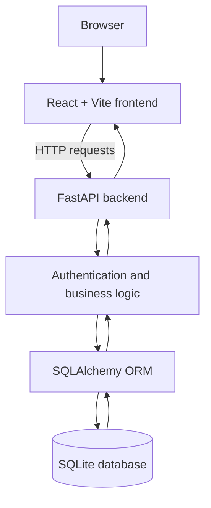
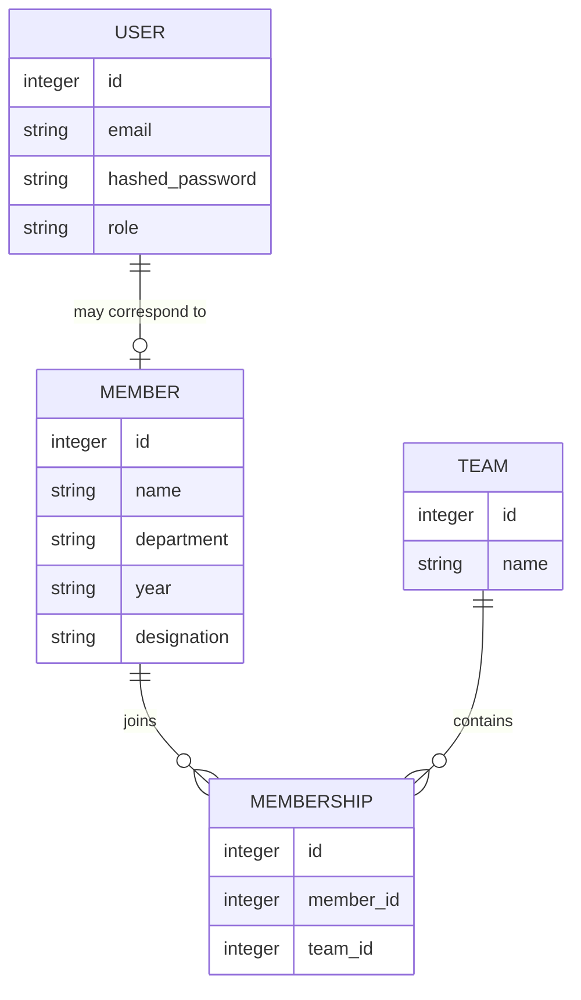

# Membership Management System (MMS)

A full-stack membership management application developed for the **ACM NITK Web Team recruitment task**.

> **Demo video:https://drive.google.com/file/d/1kxFRofG7_tJNCN7UlKwDRGh5Y2XhaVWJ/view?usp=sharing**  
> Replace this placeholder with the shareable link to your final demo video before submission.

## Overview

MMS provides a centralised interface for browsing membership records, opening member details, managing records through administrator controls, and exploring teams / Special Interest Groups (SIGs). The project separates the frontend, backend API, and database into distinct layers.

## Features

- Member directory and individual member details.
- Administrator controls for adding and editing member records.
- Teams / SIG directory, including Sanganitra, Vidyut, Saahitya, Yantrika, Karyavarta, and Abhivyakta.
- Authentication routes for registration, login, and the current authenticated account.
- JWT-based authentication and password hashing.
- Role-aware frontend navigation and controls: selected administrative actions and navigation items are hidden in the regular-member interface.
- Interactive API documentation generated by FastAPI.

> Frontend visibility is not a replacement for backend authorisation. Protected API routes must independently verify the user's role and permissions.

## Tech Stack

| Layer | Technology | Purpose |
|---|---|---|
| Frontend | React | User interface and reusable components |
| Frontend tooling | Vite | Development server and build tooling |
| Backend | Python, FastAPI | HTTP API and application logic |
| Database | SQLite | Local relational data storage |
| ORM | SQLAlchemy | Python-to-database object-relational mapping |
| Authentication | JWT and password hashing | Token-based authentication and credential protection |
| API docs | OpenAPI / Swagger UI | Inspect and test available API endpoints |

## Architecture



Typical request flow:
1. The user interacts with the React frontend.
2. The frontend sends an HTTP request to FastAPI.
3. The backend validates the request and applies application logic.
4. SQLAlchemy interacts with SQLite when data is required.
5. The backend returns a response and the frontend updates the interface.

## Project Structure

```text
MMS/
├── frontend/
│   ├── src/
│   │   ├── components/
│   │   ├── App.jsx
│   │   ├── api.js
│   │   └── ...
│   ├── package.json
│   └── ...
├── backend/
│   ├── main.py
│   ├── models.py
│   ├── auth.py
│   ├── database.py
│   ├── ...
│   └── mms.db
└── README.md
```

The local `mms.db` file may contain development/demo data. Preserve it when restarting the app, but do not commit real personal information or secrets.

## Data Model

The application distinguishes login accounts from member-directory records and also includes teams / SIGs and membership associations. The diagram below is a **conceptual overview**; verify exact columns and relationships against `backend/models.py` before treating it as the definitive schema.



**Implementation note:** `User` login accounts and `Member` directory records are separate concepts in the current application. Registering an account does not necessarily create a matching member-directory record automatically.

## Getting Started

### Prerequisites

- Python (use a version supported by the backend dependencies).
- Node.js and npm.
- Git, if cloning the repository.

### 1. Clone the repository

```bash
git clone https://github.com/Arjuna1508/Membership-Management-System.git
cd Membership-Management-System
```

### 2. Set up the backend

In a Windows Command Prompt:

```cmd
cd backend
python -m venv .venv
.venv\Scripts\activate
python -m pip install --upgrade pip
```

If `backend/requirements.txt` exists, install its dependencies:

```cmd
pip install -r requirements.txt
```

If the repository does not contain a requirements file, add one based on the packages actually used by the backend before distributing the project; do not guess dependency versions.

### 3. Configure the secret key

The authentication setup expects `MMS_SECRET_KEY`. Generate a strong key locally:

```cmd
python -c "import secrets; print(secrets.token_urlsafe(48))"
```

Copy the generated value into the same terminal:

```cmd
set MMS_SECRET_KEY=PASTE_YOUR_GENERATED_KEY_HERE
```

Keep the key private. Never commit real secrets, passwords, or tokens. The `set` command applies only to that Command Prompt session, so configure it again in a new terminal unless your environment loads it another way.

### 4. Run the backend

From `backend/`, with the virtual environment activated and the key configured:

```cmd
uvicorn main:app --reload
```

Useful local URLs:
- Backend: `http://127.0.0.1:8000`
- Swagger UI: `http://127.0.0.1:8000/docs`
- OpenAPI schema: `http://127.0.0.1:8000/openapi.json`

Keep the backend terminal running.

### 5. Install and run the frontend

Open a second terminal:

```cmd
cd frontend
npm install
npm run dev
```

Open the local URL printed by Vite, usually `http://localhost:5173/`. Keep both terminals running while using the application.

## Environment Variables

| Variable | Purpose |
|---|---|
| `MMS_SECRET_KEY` | Secret used by the authentication setup to sign/verify tokens. Keep it private. |

Document any additional environment variables if they are introduced in the code. Do not put actual secret values in this README.

## API Documentation

FastAPI generates interactive API documentation. Start the backend and open **[Swagger UI](http://localhost:8000/docs)** to inspect the routes and their actual request/response schemas.

The authentication routes in the current application include:

| Method | Route | Purpose |
|---|---|---|
| `POST` | `/auth/register` | Register an account |
| `POST` | `/auth/login` | Authenticate and obtain a token |
| `GET` | `/auth/me` | Retrieve the authenticated account |

Refer to Swagger UI for the complete, current list of member, team, and membership endpoints. Avoid executing write/delete requests against data you need to preserve.

## Authentication and Access Control

- The frontend sends the authentication token with authenticated API requests.
- The authentication module uses JWT-based tokens and password hashing.
- The frontend uses the logged-in user's role to determine which navigation items and controls are shown.
- Regular members can browse member information in the interface, while selected administrative controls are hidden.

For a secure deployment, every restricted backend endpoint must independently enforce authorisation. Hiding a button in the frontend alone does not prevent a user from calling an API directly.

## Known Limitations and Future Improvements

- **Account-to-member linking:** Creating a login account does not necessarily create a matching member-directory record automatically.
- **Backend permission verification:** Independently test every protected write endpoint to confirm that non-admin users cannot bypass the frontend and perform restricted actions.
- **SIG assignment:** The SIG directory can be demonstrated, but assignment workflows should be tested end-to-end before being described as fully working.
- **Automated tests:** Add backend API tests for authentication, member operations, and role-based permissions, along with frontend tests.
- **Production readiness:** Improve production secret management, configuration, deployment instructions, and error handling.
- **Validation:** Test invalid inputs, duplicate records, and API error states across the frontend and backend.

This section distinguishes visible interface features from behaviours that still need end-to-end verification.

## Demo Data and Screenshots

The local demo uses fictional sample member records. They are for demonstration only and are not real member information.

Optional screenshots to add:
- Login page
- Administrator dashboard and member directory
- Member details
- Teams / SIG directory
- Regular-member interface

## References

- [React](https://react.dev/)
- [Vite](https://vite.dev/guide/)
- [FastAPI](https://fastapi.tiangolo.com/)
- [SQLAlchemy](https://docs.sqlalchemy.org/)
- [SQLite](https://www.sqlite.org/docs.html)
- [Python](https://docs.python.org/3/)
- [OpenAPI specification](https://spec.openapis.org/oas/latest.html)

## Author

**Mayank Kothari**  
Project: Membership Management System (MMS)  
Repository: [Arjuna1508/Membership-Management-System](https://github.com/Arjuna1508/Membership-Management-System)
